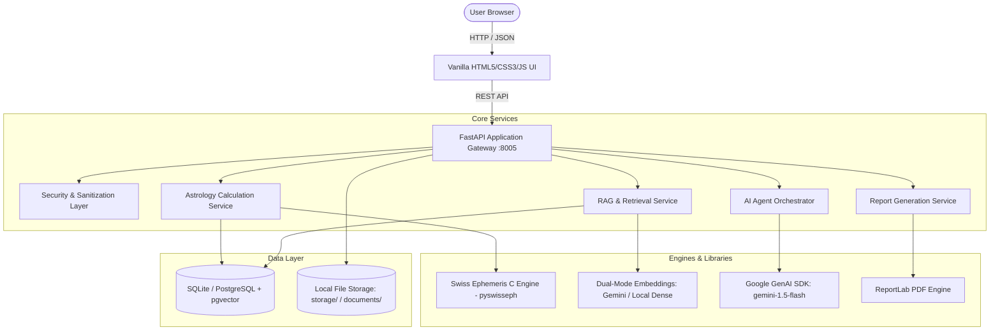
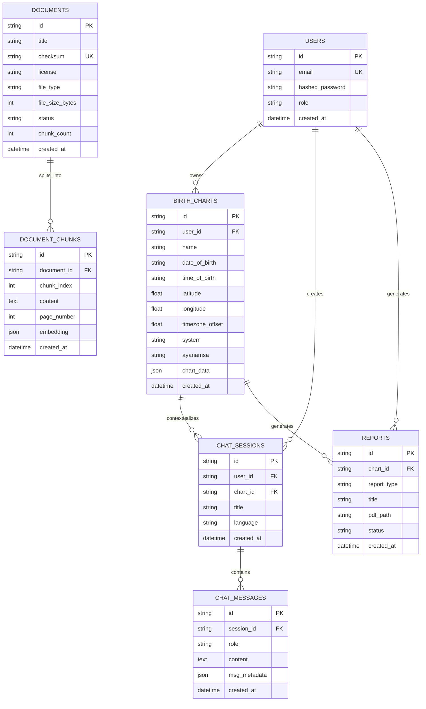

# AstroAI Agent - System Architecture & Technical Specifications

## 1. High-Level Architecture Overview

AstroAI Agent follows a clean, decoupled, layered micro-monolith architecture designed for high astronomical precision, strict AI safety, and modular extensibility.

---

## 2. Component Specifications

### 2.1 Frontend Architecture (`frontend/`)
- **Technology Stack**: HTML5, CSS3, Modern Vanilla JavaScript (ES6 Modules/Objects).
- **Zero Build Step**: Works natively without Webpack, Vite, or Node.js runtime, ensuring frictionless deployment.
- **Visual Design System**:
  - Celestial starlight palette: Deep Indigo (`#070913`, `#111827`), Violet (`#6366f1`), Golden Amber (`#f59e0b`).
  - Glassmorphic panels with backdrop filters (`backdrop-filter: blur(12px)`).
  - Fully responsive CSS Grid and Flexbox layouts.
- **Modular Sub-Controllers**:
  - `api.js`: Unified HTTP client with automatic base URL detection, error handling, and payload serialization.
  - `chart.js`: SVG visualizer for the North Indian diamond Kundali chart and tabular data formatting.
  - `chat.js`: Consultation chat manager with conversation history, citation chips, and language selection.
  - `reports.js`: Asynchronous PDF report generator with live status polling and direct download triggers.
  - `app.js`: Tab orchestration, global telemetry polling, and form lifecycle management.

### 2.2 Astrology Calculation Engine (`backend/app/astrology/`)
- **Core Library**: `pyswisseph` (version 2.10.3.2) wrapping the Swiss Ephemeris C engine.
- **Coordinate Precision**:
  - Julian Day calculation in Universal Time (`swe.julday`).
  - Planetary coordinates computed with `swe.FLG_SWIEPH | swe.FLG_SPEED | swe.FLG_SIDEREAL`.
  - True Lunar Node (`swe.TRUE_NODE`) and Ketu calculated at exactly $180^\circ$ opposition.
- **Ayanamsa Support**:
  - Lahiri (Chitra Paksha, `swe.SIDM_LAHIRI`).
  - B.V. Raman (`swe.SIDM_RAMAN`).
  - Krishnamurti (KP, `swe.SIDM_KRISHNAMURTI`).
- **House Systems**:
  - Whole Sign houses (standard for Vedic Jyotish).
  - Placidus houses (for Western Tropical systems).
- **Vimshottari Dasha Engine**:
  - Computes exact balance of the ruling Mahadasha from the Moon's traversed arc in its natal Nakshatra.
  - Generates the full 120-year cycle of 9 Mahadashas with exact start and end Gregorian dates.
- **Navamsha (D9) Engine**:
  - Computes divisional 9-fold segments ($3^\circ 20'$) according to Movable, Fixed, and Dual sign modalities.

### 2.3 RAG Knowledge Base Architecture (`backend/app/rag/`)
- **Ingestion Pipeline**:
  - Supports PDF (`fitz` PyMuPDF with `pypdf` fallback), DOCX (`python-docx`), Markdown, and plain text.
  - Computes SHA256 file checksums to guarantee duplicate prevention.
  - Semantic chunking ($650$ characters, $120$ characters overlap) preserving section headings and page provenance.
- **Embedding Generation**:
  - **Live Mode**: Google `text-embedding-004` through `google.genai`.
  - **Demo/Local Mode**: Deterministic 64-dimensional normalized n-gram dense vectorizer ensuring zero-credential offline functionality.
- **Retrieval Engine**:
  - Cosine similarity ranking with threshold filtering.
  - Generates citations with document title, author, page number, and sanitized verbatim excerpt.

### 2.4 Controlled AI Agent Orchestrator (`backend/app/agents/`)
- **Philosophy**: Controlled, bounded tool execution without unconstrained autonomous loops.
- **Security Boundaries**:
  - Maximum 5 tool calls per invocation.
  - 15-second execution timeout ceiling.
  - Strict Pydantic v2 input and output validation.
  - Destructive tools require human confirmation.
- **Registered Tools**:
  1. `calculate_birth_chart`
  2. `validate_birth_details`
  3. `retrieve_astrology_knowledge`
  4. `explain_planetary_positions`
  5. `evaluate_compatibility_rules`
  6. `generate_horoscope`
  7. `summarize_consultation`

---

## 3. Database Schema & Entity Relationship

