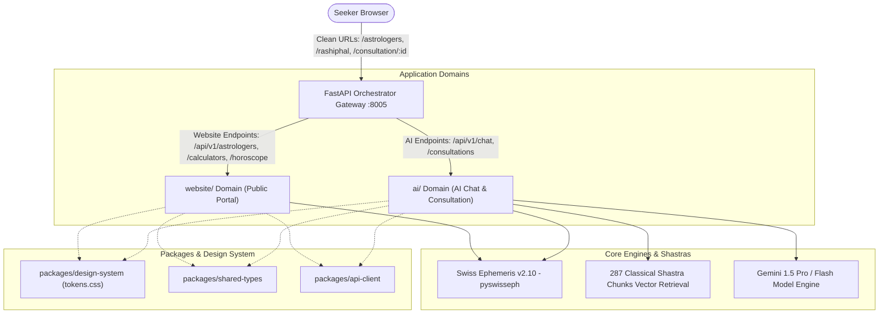

# Astro Jyotish - System Architecture & Technical Specifications

## 1. High-Level Architecture Overview

Astro Jyotish is architected into two primary application domains, supported by reusable packages and a unified gateway:

1. **`ai/` Domain:** Dedicated AI Chatbot, Astrologer Personas, RAG, and Consultation Streaming Workspace.
2. **`website/` Domain:** Public Website, Astrologer Directory, Horoscope (Rashiphal), Jyotish Calculators, and Panchang.
3. **`packages/`:** Reusable shared design tokens (`design-system`), shared Pydantic models & TypeScript contracts (`shared-types`), and isomorphic universal client (`api-client`).
4. **Unified Gateway (`backend/app/main.py`):** High-performance FastAPI orchestration gateway supporting clean HTML5 History API routing, CORS, GZip compression, and static asset distribution.



---

## 2. Directory Structure

```
AstroJyotish/
├── ai/
│   ├── frontend/
│   │   ├── index.html
│   │   ├── package.json
│   │   └── src/
│   │       ├── components/
│   │       │   ├── ConsultationHeader/    # Compact consultation topbar, audio call, live timer
│   │       │   ├── DashaQuickStrip/       # Floating active Lagna, Nakshatra, Dasha strip
│   │       │   ├── MessageList/           # Scroll area with Sri Yantra geometric watermark
│   │       │   ├── MessageBubble/         # User (purple) and Assistant (cream/gold) bubbles
│   │       │   ├── MessageComposer/       # WhatsApp-style input, attachments, mic, send
│   │       │   ├── AnalyzingIndicator/    # Rotating chakra, विचार मुद्रा state
│   │       │   ├── ContextChips/          # Dynamic context-aware suggestion chips
│   │       │   ├── VedicRemedyCard/       # Shastra remedy card with mantra, save, reminder
│   │       │   ├── MuhuratTimeline/       # Favorable Shubh Muhurat window bar
│   │       │   ├── VoiceNotePlayer/       # Audio blessing note with waveform visualizer
│   │       │   └── KundliBottomSheet/     # Sliding North Indian Kundli & Planetary Degrees
│   │       ├── routes/router.js
│   │       └── styles/
│   └── backend/
│       ├── app/
│       │   ├── api/                       # chat.py, agent.py, consultations.py, documents.py
│       │   ├── agents/                    # consultation_agent, prompt_personas, tools
│       │   ├── astrology/                 # Swiss Ephemeris calculations, Kundli SVG
│       │   ├── core/                      # config, logging
│       │   ├── db/                        # session, models
│       │   ├── providers/                 # gemini_provider, mock_provider
│       │   ├── rag/                       # retriever, vector_store, embeddings
│       │   └── main.py                    # Standalone AI backend service (:8001)
│       ├── tests/
│       └── requirements.txt
│
├── website/
│   ├── frontend/
│   │   ├── index.html
│   │   ├── package.json
│   │   └── src/
│   │       ├── components/
│   │       │   ├── Navbar/                # Clean brand header, 23-language picker, wallet
│   │       │   ├── Hero/                  # Vedic headline, search input, stats, CTAs
│   │       │   ├── AstrologerSearch/      # Search toolbar, specialty, language, price sort
│   │       │   ├── AstrologerCard/        # Verified scholar card, portrait, pricing, actions
│   │       │   ├── FeaturedAstrologers/   # Curated scholar carousel/grid
│   │       │   ├── CategoryCard/          # Problem categories (Career, Marriage, Wealth)
│   │       │   ├── DailyHoroscope/        # 12 Zodiac sign tabs, daily forecast, lucky elements
│   │       │   ├── PanchangPreview/       # Today's Tithi, Nakshatra, Yoga, Rahu Kaal
│   │       │   ├── Calculators/           # Milan, Janam Kundli, Sade Sati, Manglik, Gemstones
│   │       │   ├── Testimonials/          # Verified seeker reviews & ratings
│   │       │   ├── TrustStats/            # Swiss Ephemeris precision & Shastra grounding
│   │       │   ├── FeatureShortcuts/      # Quick navigation pills
│   │       │   ├── WhyChoose/             # Classical Parashara vs generic AI bots
│   │       │   ├── FAQAccordion/          # Collapsible Vedic Jyotish FAQ
│   │       │   ├── BlogCards/             # Shastra research articles
│   │       │   ├── AppPromo/              # Mobile application banner
│   │       │   ├── GlobalFooter/          # Complete 5-column responsive footer & legal
│   │       │   ├── GlobalLoader/          # Saffron chakra spinner
│   │       │   ├── Toast/                 # Notifications container
│   │       │   └── Modal/                 # Modal shell
│   │       ├── routes/router.js
│   │       └── styles/
│   └── backend/
│       ├── app/
│       │   ├── api/                       # astrologers.py, calculators.py, horoscope.py, charts.py, auth.py, wallet.py, reports.py
│       │   ├── core/
│       │   ├── db/
│       │   ├── models/
│       │   ├── repositories/
│       │   ├── schemas/
│       │   ├── services/
│       │   └── main.py                    # Standalone Website backend service (:8002)
│       ├── tests/
│       └── requirements.txt
│
├── packages/
│   ├── api-client/                        # Universal AstroApiClient isomorphic module
│   ├── design-system/tokens.css           # Deep Navy, Royal Purple, Warm Cream, Gold tokens
│   └── shared-types/                      # Pydantic & TypeScript astrologer, consultation, user models
│
├── backend/                               # Unified production gateway orchestrator (:8005)
├── frontend/                              # Consolidated client distribution with clean URLs
├── storage/                               # Generated PDF reports and documents
├── documents/                             # 287 classical Vedic Shastra text chunks
└── docker-compose.yml
```

---

## 3. Clean URL Routing Engine

All hash-based routing (`/#/...`) has been replaced with the standard **HTML5 History API Router**:
- `/` -> Homepage
- `/astrologers` -> Astrologer Directory
- `/astrologers/:slug` -> Astrologer Profile
- `/consultation/:id` -> Full-screen AI Consultation Workspace
- `/rashiphal` -> Daily Horoscope
- `/calculators` -> Jyotish Calculators & Kundali Milan
- `/panchang` -> Aaj Ka Panchang

The gateway in `backend/app/main.py` provides SPA fallback routing (`/{full_path:path}`) so direct page requests and browser refreshes work natively with HTTP 200.

---

## 4. Test Suite Verification

The project includes 120 automated test cases across all domains:
- `backend/tests/`: 113 tests covering calculations, RAG, safety guardrails, personas, and WhatsApp consultation features.
- `ai/backend/tests/`: 3 domain tests verifying AI health, consultation sessions, and input validation.
- `website/backend/tests/`: 4 domain tests verifying website health, astrologers directory, horoscope readings, and calculators.
- **Pass Rate:** 120 / 120 (100% Passed).
