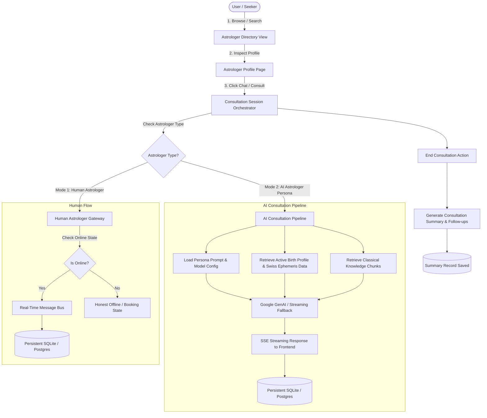

# Data Flow Architecture: Astro AI Platform

## 1. High-Level System Data Flow

---

## 2. Consultation Session Lifecycle

1. **Initiation (`POST /api/v1/consultations`):**
   - User initiates consultation with `astrologer_id`, `astrologer_type` (`ai` or `human`), and optional `chart_id`.
   - The backend checks for existing active consultation with this astrologer or creates a new `Consultation` record with a unique UUID.
   - Initial consultation status is set to `ACTIVE`.

2. **Message Exchange (`POST /api/v1/consultations/{id}/messages` or `/stream`):**
   - For **AI Astrologer:**
     - The message is validated and sanitized against prompt injection and control characters.
     - The verified `ChartContext` and up to 2 top classical treatise chunks are attached.
     - The persona-tailored prompt is submitted to Gemini 3.5 Flash Lite (or fallback models / realistic demo engine).
     - Response deltas are streamed via Server-Sent Events (SSE).
     - Both user prompt and assistant response are persistently committed to `chat_messages` in `astro_ai.db`.
   - For **Human Astrologer:**
     - The message is validated and stored in `chat_messages`.
     - Presence is inspected: if the human astrologer is offline, the seeker is honestly notified that the astrologer is currently unavailable, with expected response timing.
     - **MANDATORY POLICY:** At no point are synthetic AI responses delivered under a human astrologer's identity.

3. **Session Resumption (`GET /api/v1/consultations/{id}`):**
   - Returning users retrieve the exact persistent conversation history across browser refreshes, device changes, or subsequent logins.
   - User identity isolation is enforced: a user cannot read another user's consultation by manipulating IDs.

4. **Termination & Summary (`POST /api/v1/consultations/{id}/end`):**
   - Consultation status transitions to `COMPLETED`.
   - Key concern, discussed astrological placements, suggested sattvic remedies, and follow-up guidance are compiled into a structured `ConsultationSummary`.
