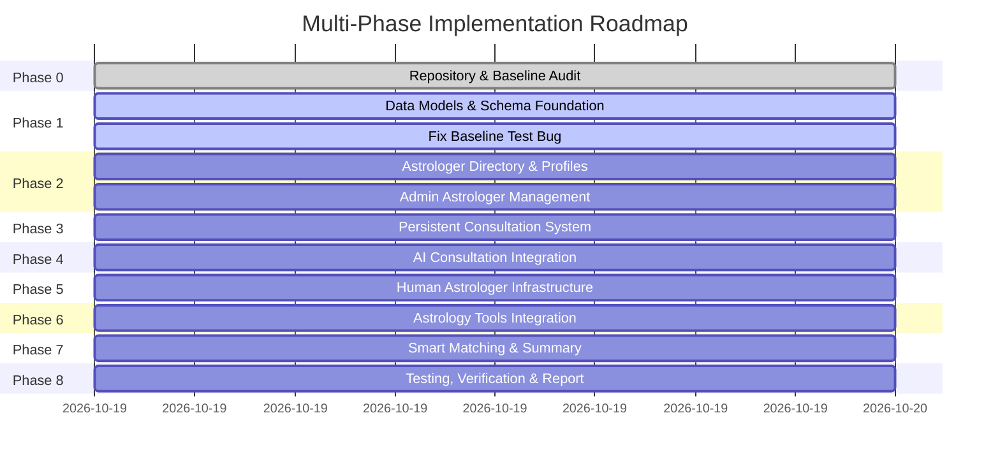

# Implementation Roadmap: Astro AI Platform Upgrade

## Phase Breakdown

---

### Phase 0: Mandatory Repository Audit (COMPLETED)
- Inspect tree, stack, baseline tests, models, Vercel configuration, and existing 4.4MB SQLite database.
- Document audit results, current folder structure, feature inventory, data flow, and roadmap.

### Phase 1: Architecture & Data Foundations
- Fix `self.profile_id = profile_id` bug in `backend/app/astrology/chart_context.py` to restore baseline tests to 100% pass rate.
- Extend `backend/app/models/models.py` with:
  - `Astrologer` (profile, slug, name, bio, pricing, rating, experience, languages, specialties, is_ai, availability)
  - `AstrologerReview` (rating, review text, user_id, verified status)
  - `Consultation` (id, user_id, astrologer_id, astrologer_type, status, pricing snapshot, timestamps)
  - `ConsultationSummary` (concern, key points, remedies, next steps)
- Update `backend/app/db/session.py` with safe, non-destructive migration logic to create and upgrade tables automatically without touching existing records.
- Seed realistic astrologer profiles into DB (both AI personas and genuine astrologer profiles) with clear AI labeling.

### Phase 2: Dynamic Website & Astrologer Directory
- Build Astrologer Directory endpoints:
  - `GET /api/v1/astrologers` (search, language/expertise/price/experience filters, sorting, pagination)
  - `GET /api/v1/astrologers/{slug_or_id}` (profile detail, reviews, availability)
  - `POST /api/v1/astrologers` (admin-managed profile creation/updates)
- Build Astrologer Directory frontend UI view:
  - Clean card grid with avatar, name, experience, languages, verified badges, rating, price, and instant "Chat" / "Profile" CTAs
  - Filter bar (Language, Expertise, Price, Availability)
  - Search input with debounce

### Phase 3: Persistent Consultation System
- Implement Consultation endpoints:
  - `POST /api/v1/consultations` (start or resume session with selected astrologer)
  - `GET /api/v1/consultations` (user's consultation history)
  - `GET /api/v1/consultations/{id}` (fetch session details & messages)
  - `POST /api/v1/consultations/{id}/messages` (send message)
  - `POST /api/v1/consultations/{id}/end` (conclude session)
- Store messages persistently linked to `consultation_id` and selected `astrologer_id`.
- Ensure sessions persist across refreshes, navigation, and re-entry.

### Phase 4: AI Consultation Integration
- Connect selected AI persona to existing AI backend (`LLMService`, `AgentOrchestrator`, `RetrievalService`).
- Pass selected persona system prompt, verified `ChartContext`, and retrieved classical knowledge.
- Support streaming SSE responses with full history resumption.

### Phase 5: Human Astrologer Infrastructure
- Implement honest availability states: `online`, `busy`, `offline`.
- Human astrologer messaging flow with honest offline notices (NEVER fake AI replies).

### Phase 6: Astrology Tools & Reports Verification
- Verify that Kundali Milan, Aaj Ka Panchang, Sade Sati, SVG Kundli rendering, and PDF reports remain fully functional.

### Phase 7: Advanced Features
- Implement Smart Astrologer Matching (`GET /api/v1/astrologers/match` based on user concern, language, and budget).
- Implement Consultation Summary generator (`POST /api/v1/consultations/{id}/summary`).
- Add user authentication & saved profile management.

### Phase 8: Testing, QA & Final Report
- Run full pytest test suite (ensuring 0 regressions).
- Add new tests for astrologer directory, consultation persistence, matching, and summary.
- Produce final `docs/implementation_report.md`.
