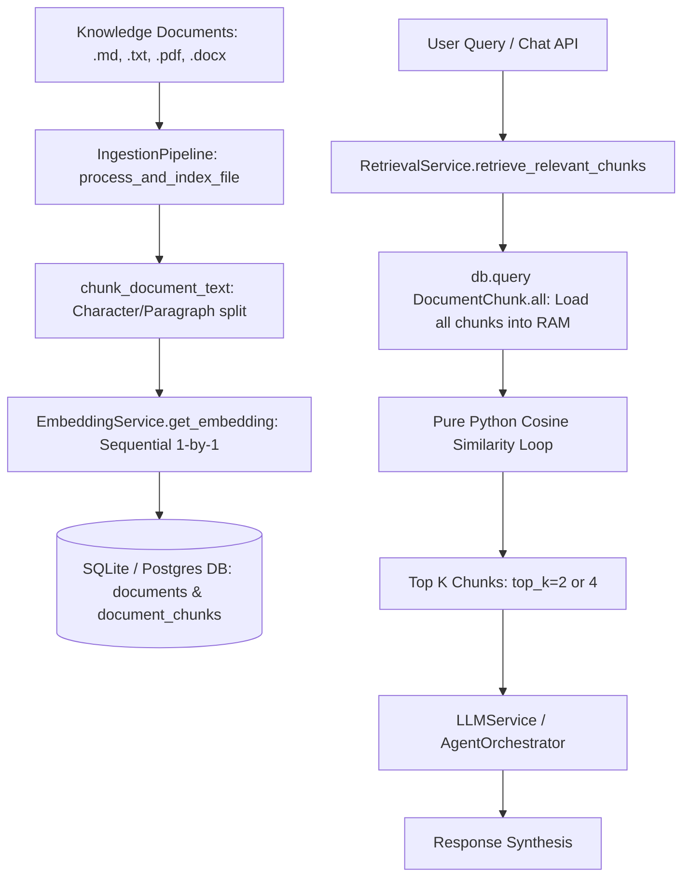

# Comprehensive Code Audit & Architecture Review: AstroAI RAG Pipeline

**Document Version:** 1.0.0  
**Audit Date:** 2026-10-16  
**Auditor:** Senior AI Engineer, RAG Architect, Python Backend Developer & Vedic Knowledge Systems Specialist  
**Repository:** `AstroTalk`  
**Target Subsystems:** Document Ingestion, ASTRO Semantic Chunking, Embedding Service, Hybrid Retrieval, AI Grounding, Database & Knowledge Base Architecture

---

## 1. Executive Summary

A comprehensive architectural and code-level audit was conducted on the AstroAI RAG subsystem located in `backend/app/rag/`, its integration layers (`backend/app/agents/`, `backend/app/services/llm_service.py`, `backend/app/api/chat.py`), database models (`backend/app/models/models.py`), and knowledge assets (`documents/`).

While the project features a solid foundation with Swiss Ephemeris astronomical calculations (`backend/app/astrology/`), FastAPI endpoints, and Pydantic validation, the existing RAG pipeline is constrained by prototype-level implementations that fail production readiness criteria. Key issues include:
1. **Linear in-memory search** iterating through unindexed database records in pure Python.
2. **Missing keyword and hybrid search** (no BM25 or Reciprocal Rank Fusion, despite `rank-bm25` and `scikit-learn` availability).
3. **No batching in embeddings or ingestion**, causing extreme I/O overhead.
4. **Dangerous vector space mixing** between 64-dimensional local fallback hash vectors and 768-dimensional Google GenAI embeddings.
5. **Brittle chunking** that splits Sanskrit verses, shlokas, tables, and sentences midway through words.
6. **Incomplete update lifecycle** where modifying or failing a document creates duplicate records or permanent ingestion locks.

Below is the detailed diagnostic of confirmed defects, risk assessment, and the end-to-end implementation roadmap.

---

## 2. Current Architecture Overview



### Component Analysis:
* **Document Extraction (`backend/app/rag/ingestion.py`):**
  Uses PyMuPDF / `pypdf` for PDFs, `python-docx` for Word documents, and standard file read for TXT/MD. Unsupported formats or corrupt files cause unhandled or unrecoverable exceptions. JSON is not supported.
* **Chunking Engine (`backend/app/rag/chunking.py`):**
  Uses a paragraph accumulator up to `chunk_size=600` characters with `chunk_overlap=100`. Splits oversized text by raw slice indices `para[i:i + chunk_size]`.
* **Embedding Service (`backend/app/rag/embeddings.py`):**
  Attempts Google GenAI `gemini-embedding-001` or falls back to `_generate_local_vector` (64-dim L2-normalized MD5 n-gram hash). Embeds one text at a time synchronously.
* **Database & Vector Store (`backend/app/models/models.py`, `backend/app/db/session.py`):**
  Uses SQLAlchemy with SQLite (`astro_ai.db`). Vectors are serialized as JSON arrays (`Column(JSON)`) inside the `document_chunks` table.
* **Retrieval Engine (`backend/app/rag/retrieval.py`):**
  Executes `db.query(DocumentChunk, Document).all()`, loads all embeddings, computes cosine similarity in a Python loop, and filters by `min_score=0.12`.
* **Grounding & Chat (`backend/app/services/llm_service.py`):**
  Formats top 2 retrieved citations as `[Title - P.X]: Excerpt` in the Gemini prompt; in demo mode, uses rule-based text without grounding on citations.

---

## 3. Confirmed Defects with File References

### Defect 1: Re-Ingestion Failure & Permanent Ingestion Lock
* **File:** [backend/app/rag/ingestion.py](file:///c:/Users/og/OneDrive/Desktop/AstroTalk/backend/app/rag/ingestion.py#L115-L137)
* **Code:**
  ```python
  existing_doc = db.query(Document).filter(Document.checksum == checksum).first()
  if existing_doc:
      return existing_doc
  # ...
  doc_record.status = "PROCESSING"
  db.add(doc_record)
  db.commit()
  ```
* **Issue:** 
  1. If an ingestion process crashes or fails midway, `doc_record` is saved with `status="FAILED"`. If the user runs ingestion again, the checksum check matches the failed document and returns it immediately as "already indexed", locking the document out of ever being re-indexed without manual database surgery.
  2. If a document is updated on disk (changing its checksum), a new `Document` row is created with the same `file_path`. The old `Document` row and all its associated chunks remain active in the database, resulting in stale duplicate chunks appearing in search results.

### Defect 2: Mixing Incompatible Vector Spaces (Dimensionality & Model Collisions)
* **File:** [backend/app/rag/retrieval.py](file:///c:/Users/og/OneDrive/Desktop/AstroTalk/backend/app/rag/retrieval.py#L44-L51), [backend/app/rag/embeddings.py](file:///c:/Users/og/OneDrive/Desktop/AstroTalk/backend/app/rag/embeddings.py#L38-L64)
* **Code:**
  ```python
  if len(query_vector) == len(chunk.embedding):
      sim = EmbeddingService.cosine_similarity(query_vector, chunk.embedding)
  else:
      from backend.app.rag.embeddings import _generate_local_vector
      local_query = _generate_local_vector(query, dim=len(chunk.embedding))
      sim = EmbeddingService.cosine_similarity(local_query, chunk.embedding)
  ```
* **Issue:**
  Comparing vectors from two distinct embedding systems (or falling back to a hash-based query vector against stored chunks) violates semantic vector geometry. The similarity score becomes meaningless noise. There is no active model fingerprinting, revision tracking, or index consistency checks.

### Defect 3: Non-Deterministic Chunk IDs & Fragmented Shlokas / Tables
* **File:** [backend/app/rag/chunking.py](file:///c:/Users/og/OneDrive/Desktop/AstroTalk/backend/app/rag/chunking.py#L67-L78), [backend/app/models/models.py](file:///c:/Users/og/OneDrive/Desktop/AstroTalk/backend/app/models/models.py#L107)
* **Code:**
  ```python
  # In chunking.py:
  for i in range(0, len(para), chunk_size - chunk_overlap):
      slice_text = para[i:i + chunk_size]
  # In models.py:
  id = Column(String(36), primary_key=True, default=generate_uuid)
  ```
* **Issue:**
  1. Chunk IDs are random UUIDs generated upon insert. Every re-index creates entirely new IDs, breaking caching, evaluation benchmarks, and citation traceability.
  2. Oversized paragraphs or Sanskrit shlokas are brutally sliced across byte/character offsets without checking sentence boundaries, verse endings (`॥`, `|`), or markdown table structures. Sanskrit shlokas and their English/Hindi translations get isolated into different chunks, destroying semantic interpretability.

### Defect 4: Extreme Latency and I/O Overhead (No Embedding Batching)
* **File:** [backend/app/rag/ingestion.py](file:///c:/Users/og/OneDrive/Desktop/AstroTalk/backend/app/rag/ingestion.py#L152-L162)
* **Code:**
  ```python
  for item in chunks_data:
      vec = EmbeddingService.get_embedding(item["content"])
  ```
* **Issue:**
  Each chunk is embedded one-by-one via synchronous HTTP calls to Gemini API or single function invocations. For a 500-page classical text yielding 2,500 chunks, this incurs 2,500 round trips, triggering rate limits (429 Too Many Requests), timeouts, and multi-hour ingestion times.

### Defect 5: Unindexed In-Memory Python Linear Scan (No Vector Index, No BM25)
* **File:** [backend/app/rag/retrieval.py](file:///c:/Users/og/OneDrive/Desktop/AstroTalk/backend/app/rag/retrieval.py#L32-L68)
* **Code:**
  ```python
  chunks = db.query(DocumentChunk, Document).join(...).filter(...).all()
  for chunk, doc in chunks:
      sim = EmbeddingService.cosine_similarity(query_vector, chunk.embedding)
  ```
* **Issue:**
  Retrieval loads the entire corpus into Python process memory for every single query and computes cosine similarity in interpreted Python loops. As the knowledge base grows to tens of thousands of chunks, latency scales linearly $O(N)$ with memory bloat. No keyword search (BM25) exists, making technical terms (such as Sanskrit yogas, nakshatra padas, specific planet-house combos like "Gajakesari", "Pushya", "Vipareeta Raja Yoga") vulnerable to semantic drift.

### Defect 6: Missing Metadata Preservation and Filtering
* **File:** [backend/app/models/models.py](file:///c:/Users/og/OneDrive/Desktop/AstroTalk/backend/app/models/models.py#L104-L115)
* **Issue:**
  `DocumentChunk` lacks fields for: `topic`, `subtopic`, `language`, `chapter`, `verse_id`, `shloka_number`, `source_id`, `document_type`, and `chunk_metadata`. Callers cannot filter retrieval by topic (e.g. `topic='palmistry'` or `topic='marriage_compatibility'`).

### Defect 7: Lack of Stale Chunk Cleanup, Dry-Run Mode, and Ingestion CLI
* **File:** [backend/app/rag/ingestion.py](file:///c:/Users/og/OneDrive/Desktop/AstroTalk/backend/app/rag/ingestion.py)
* **Issue:**
  There is no CLI entrypoint (e.g., `python -m backend.app.rag.ingestion --source ...`). There is no dry-run simulation mode to inspect what would be parsed and chunked. When files are deleted or moved, orphan chunks stay in the database forever.

---

## 4. Missing Features Matrix

| Required Capability | Current State | Required State |
|:---|:---|:---|
| **Supported File Formats** | PDF, DOCX, TXT, MD | PDF, DOCX, TXT, MD, JSON, JSONL |
| **Astrology Shloka / Verse Preservation** | None (sliced arbitrarily) | Shloka + Anvaya + Translation kept unified |
| **Embedding Batching** | 1-by-1 synchronous | Configurable batch size (e.g., 32/64) with retries |
| **Embedding Vector Dimension Safety** | Silent cross-model fallback | Strict dimension validation & active model registry |
| **Local Vector Acceleration** | Pure Python loop | Vectorized NumPy / SciPy + PyTorch CUDA / CPU support |
| **Keyword Search** | Missing | BM25 Okapi with Sanskrit/Hindi/English tokenization |
| **Hybrid Retrieval** | None (semantic only) | Hybrid BM25 + Dense Vectors via Reciprocal Rank Fusion |
| **Reranking** | Missing | Optional cross-encoder reranker for high precision |
| **Metadata Filtering** | None | Filter by `topic`, `source`, `language`, `chapter` |
| **Query Normalization** | Simple lowercase | Astrology synonym & Romanized spelling normalization |
| **Ingestion CLI** | Missing | Full CLI with `--source`, `--dry-run`, `--reindex` |
| **Reporting** | Log statements only | Machine-readable JSON + formatted Markdown reports |
| **Stale Record Cleanup** | None | Automatic orphan purge on file update/delete |

---

## 5. Proposed Implementation Plan

### Phase 2: Production Ingestion Pipeline (`backend/app/rag/ingestion.py`)
1. Implement `DocumentValidator` for formats, size limits, and sanitization.
2. Add support for JSON structured knowledge files.
3. Implement `IngestionManager` with:
   - Content-hash tracking and changed-file detection.
   - Atomic replacement: delete old chunks of modified files within a transaction before saving new ones.
   - Orphan cleanup: remove chunks for files no longer present during full reindex.
   - Batched embedding generation and batched database writes.
   - Dry-run mode (`dry_run=True`) returning inspection metrics without DB writes.
   - CLI interface supporting `--source`, `--dry-run`, `--reindex`, `--concurrency`.
   - Ingestion audit reporting: generate both JSON and Markdown summaries.

### Phase 3: Intelligent Astrology-Aware Chunking (`backend/app/rag/chunking.py`)
1. Enhance `clean_text` with Unicode normalization (NFC), Devanagari punctuation (`।`, `॥`), and whitespace cleanup.
2. Implement `AstrologyAwareChunker`:
   - Detect Sanskrit verses/shlokas and retain shloka text with immediately following translation.
   - Detect Markdown headers (`#`, `##`, `###`), chapter indicators, and preserve hierarchy in chunk metadata.
   - Markdown table detection to keep tables intact without splitting mid-row.
   - Deterministic stable chunk IDs: `hash(file_checksum + chunk_index + section)`.
   - Character and token estimation with strictly enforced boundary limits.

### Phase 4: Robust Embedding Pipeline (`backend/app/rag/embeddings.py`)
1. Multi-backend embedding provider:
   - Google GenAI (`gemini-embedding-001` or `text-embedding-004`).
   - Sentence-Transformers / PyTorch (with CPU and CUDA device auto-detection).
   - High-performance normalized dense vector fallback using NumPy.
2. Vector dimension validation: Enforce exact dimension matching between index and query.
3. Batch embedding API: `get_embeddings_batch(texts: List[str], batch_size: int = 32)`.
4. In-memory caching for repeated query embeddings.

### Phase 5: Advanced Hybrid Retrieval (`backend/app/rag/retrieval.py`)
1. Fast vectorized cosine similarity using NumPy.
2. In-memory / persistent BM25 index over chunk content using `rank-bm25`.
3. Reciprocal Rank Fusion (RRF) combining dense vector rank and BM25 rank:
   $$RRF(d) = \sum_{m \in M} \frac{1}{60 + r_m(d)}$$
4. Metadata filtering support (`topic`, `source`, `chapter`, `language`).
5. Query normalizer handling transliteration variants (e.g. "shani", "sani", "kundli", "kundali", "budh", "mercury").
6. Near-duplicate suppression via Jaccard / Levenshtein overlap thresholding.
7. Structured citation payloads with source provenance, verse, page, and confidence diagnostics.

### Phase 6 & 7: Knowledge Base Expansion & Management Tools
1. Establish clean directory structure in `documents/sources/`:
   `foundations/`, `grahas_and_rashis/`, `houses_and_yogas/`, `nakshatras/`, `dashas/`, `divisional_charts/`, `marriage_compatibility/`, `career_and_finance/`, `transits/`, `panchang_and_muhurta/`, `prashna_jyotish/`, `palmistry/`.
2. Expand verified classical texts and comprehensive educational compendiums:
   - Brihat Parashara Hora Shastra principles (Panchang, Bhavas, Yogas, Dashas).
   - Ashtakoot Milan & Kundali Matching rules.
   - Navamsha (D9) and Dashamsha (D10) principles.
   - Gochar, Sade Sati & transit rules.
   - Prashna Jyotish classical foundations.
   - Hastarekha Samudrika Shastra expanded classical compendium.
3. Maintain accurate `documents/manifests/source_manifest.json` with clear provenance, licensing, and distinction between classical primary source compilations and educational commentary.
4. Build diagnostic tools:
   - Inventory analyzer, missing metadata reporter, consistency checker.

### Phase 8: AI Answer Generation & Grounding Update
1. Update `llm_service.py` to ground responses strictly on retrieved hybrid citations.
2. Explicit refusal and guidance when knowledge base contains no relevant citations.
3. Separation of Swiss Ephemeris astronomical calculations vs textual interpretive lore.

### Phase 9 & 10: Regression Testing & Operational Hardening
1. Build deterministic test suite covering chunk boundaries, Unicode/Sanskrit, BM25, RRF fusion, dry-run, idempotency, and error recovery.
2. Measure Recall@k and retrieval latency.
3. Implement path traversal safeguards, secret masking, and transaction recovery.

---

## 6. Risks and Migration Requirements

1. **Database Schema Backward Compatibility:**
   - Existing columns in `documents` and `document_chunks` must be preserved. Any new metadata fields should use optional/nullable columns or be encapsulated in JSON columns to prevent migration breakage on existing SQLite databases.
2. **Vector Space Inconsistency:**
   - The current DB holds 64-dimensional vectors. When transitioning to a high-dimensional model or upgrading, an index consistency checker must detect dimension mismatch and safely re-index without data corruption.
3. **Execution Environment Dependencies:**
   - Verify that all libraries used (`rank-bm25`, `numpy`, `PyMuPDF`, `google-genai`, `torch`) operate cleanly without mandatory cloud network requirements during testing and offline operation.

---
*Report approved for immediate phase-by-phase implementation.*
